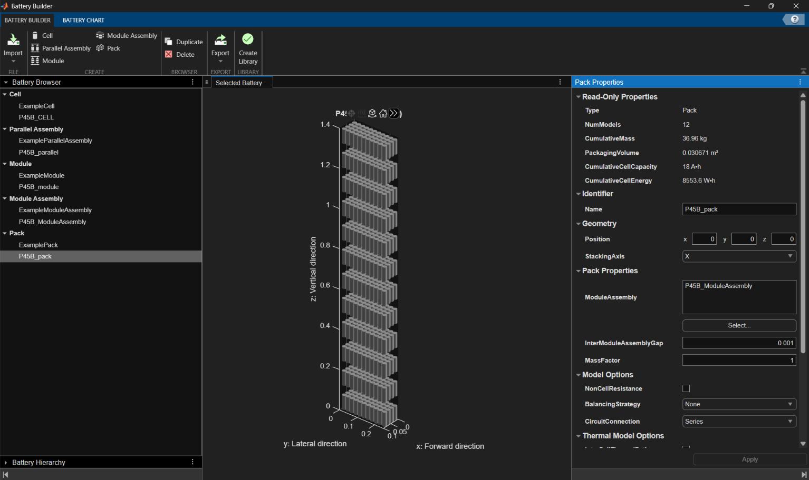
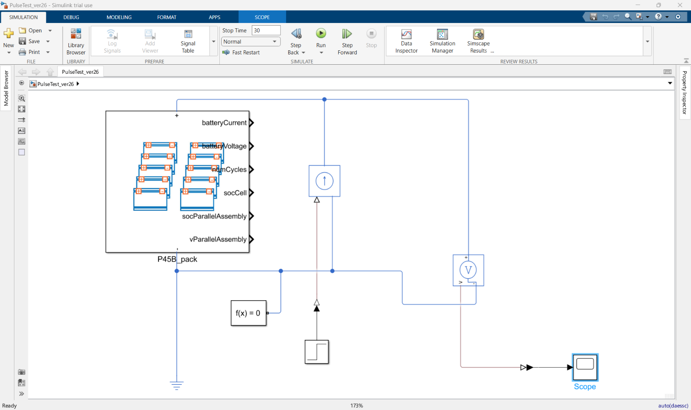
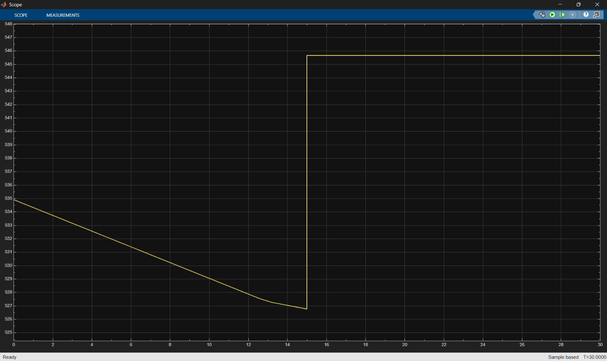

# Battery Pack Design and Pulse Test (Simscape Battery)

Design and simulation of a high-voltage battery pack built from **Molicel INR-21700-P45B** cells, with a current pulse test in Simulink / Simscape Battery.

## Task

Design a battery pack with a maximum voltage of 600 V and a capacity of 18 Ah using the Molicel P45B cell.

## Design

| Item | Value |
| --- | --- |
| Cell | Molicel P45B (4.2 V max, 3.6 V nominal, 4.5 Ah) |
| Module (segment) | 11S4P, 46.2 V max |
| Pack | 12 modules in series → 132S4P, 528 cells |
| Max voltage | 132 × 4.2 V = 554.4 V |
| Nominal voltage | 132 × 3.6 V ≈ 475 V |
| Capacity | 4 × 4.5 Ah = 18 Ah |
| Nominal energy | ≈ 8.5 kWh |
| Max continuous current | 4 × 45 A = 180 A |

A 142S4P layout would reach 596.4 V, which is too close to the 600 V limit, so the design uses 132S4P. Each 11S4P segment stays well below the FSUK 120 V segment limit.

Hand calculations: [calculation 2.png](calculation%202.png), [calculations 1.png](calculations%201.png)

## Pulse test

`PulseTest_ver26.slx` drives the pack with a step current source and measures the terminal voltage on a scope. Simulation stop time is 30 s.

A recording of the simulation run is in [Running Pulse-test.mp4](Running%20Pulse-test.mp4).

## Files

| File | Description |
| --- | --- |
| `PulseTest_ver26.slx` | Simulink pulse-test model |
| `Batteries_lib.slx` | Generated Simscape Battery library (module and parallel assembly blocks) |
| `P45B_pack.mat` | Battery pack object exported from Battery Builder |
| `+Batteries/` | Generated Simscape components for the module and parallel assembly |
| `+BatteriesLumpingAdapters/` | Electrical lumping adapter component |

## Requirements

MATLAB R2026a with Simulink, Simscape, Simscape Electrical and Simscape Battery.

## Running

1. Open MATLAB in this folder so the `+Batteries` packages are on the path.
2. Open `PulseTest_ver26.slx`.
3. Run the simulation and open the Scope to see the pack voltage.
